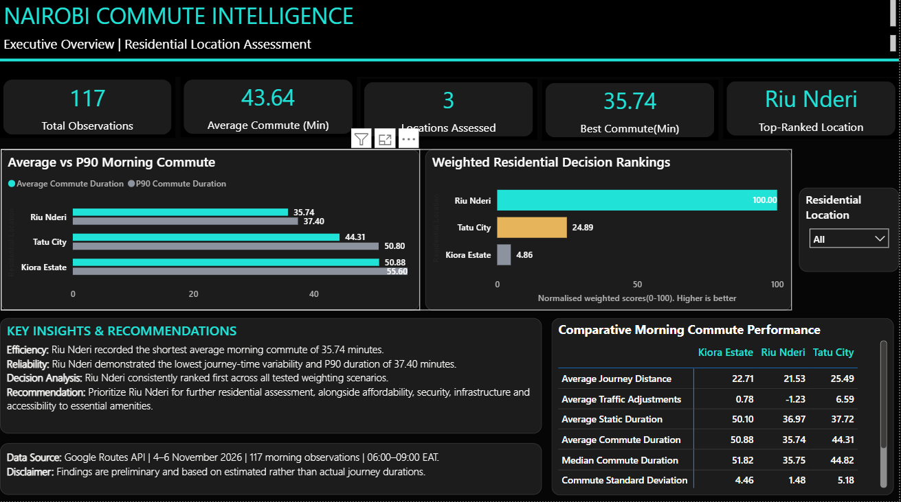
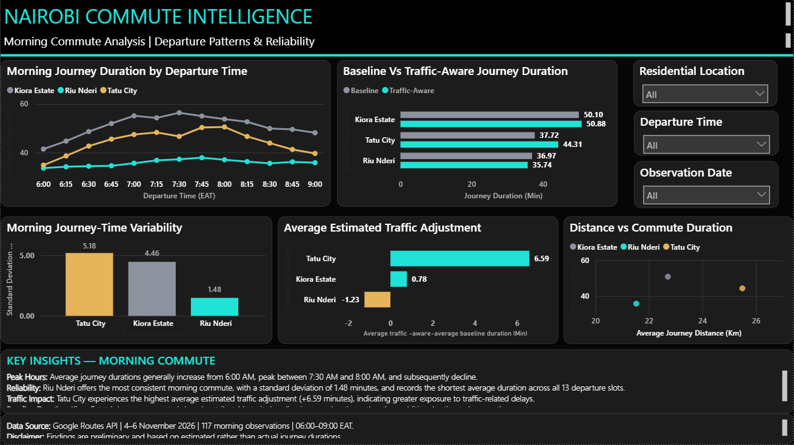

# Nairobi Commute Intelligence
### A Data-Driven Residential Location Assessment

**Tools:** Python | Google Maps Routes API | Power BI | Google Cloud  
**Location:** Nairobi & Kiambu County, Kenya  
**Study Period:** 4–6 November 2026

## Project Overview

This project uses data analytics to evaluate morning commuting efficiency and reliability across three potential residential locations in Kiambu County:

- Kiora Estate (Kirigiti)
- Riu Nderi (Gikambura)
- Tatu City (Ruiru)

The objective was to identify which location offers the most efficient and reliable estimated morning commute to Westlands, Nairobi.

Using the Google Maps Routes API, I collected 234 journey-time estimates over three days. The final decision analysis focused on 117 morning observations.

## Key Findings

| Location | Average Commute | P90 Duration | Variability |
|---|---:|---:|---:|
| Riu Nderi | 35.74 min | 37.40 min | 1.48 min |
| Tatu City | 44.31 min | 50.80 min | 5.18 min |
| Kiora Estate | 50.88 min | 55.60 min | 4.46 min |

**Riu Nderi emerged as the strongest commuting option**, with the shortest average journey duration and lowest variability.

## Decision Analysis

A weighted decision model was developed using:

- P90 Commute Duration — 45%
- Average Commute Duration — 30%
- Journey-Time Variability — 25%

### Final Rankings

| Rank | Location | Weighted Score |
|---|---|---:|
| 1 | Riu Nderi | 100.00 |
| 2 | Tatu City | 24.89 |
| 3 | Kiora Estate | 4.86 |

Sensitivity analysis confirmed that the rankings remained unchanged across three alternative weighting scenarios.

## Power BI Dashboard

I developed an interactive three-page Power BI dashboard
to communicate the analytical findings and support
residential location decision-making.

### 1. Executive Summary

Provides an overview of commuting performance, key
metrics and weighted residential location rankings.

### 2. Morning Commute Analysis

Explores journey-time patterns, commuting reliability,
traffic adjustments and journey distance.

### 3. Decision Analysis

Presents the weighted decision model, normalised
performance scores and sensitivity analysis.

## Technical Skills Demonstrated

Python data analysis | API integration | Data cleaning | Statistical analysis | Decision modelling | Sensitivity analysis | Power BI | DAX | Data visualisation

## Full Project Report

For a detailed explanation of the methodology, statistical analysis,
decision model, sensitivity testing and recommendations:

📄 [Read the Full Project Report](reports/Nairobi_Commute_Intelligence_Project_Report.pdf)

## Limitations

Findings are based on three days of Google Maps API-estimated journey times, not actual completed journeys. The final assessment focuses on morning commuting and excludes property affordability, security and amenities.

## Author

**DS Cyrus Wambugu Macharia**  
Nairobi, Kenya | November 2026

